# Diagrama de Base de Datos - CertiNanas

```mermaid
erDiagram
    Roles {
        int Id PK
        string Nombre UK
        string Descripcion
        datetime FechaCreacion
    }

    Usuarios {
        int Id PK
        string Email UK
        string PasswordHash
        string Nombres
        string Apellidos
        string NumeroDocumento
        string TipoDocumento
        string Telefono
        int IdRol FK
        bool EmailConfirmado
        bool TerminosAceptados
        bool Activo
        bool Suspendido
        string FotoPerfil
        datetime FechaCreacion
    }

    Especialidades {
        int Id PK
        string Nombre UK
        string Descripcion
        bool Activo
        datetime FechaCreacion
    }

    Areas {
        int Id PK
        string Nombre UK
        string Descripcion
        bool Activo
        datetime FechaCreacion
    }

    Cuidadoras {
        int Id PK
        int IdUsuario FK
        int AniosExperiencia
        real TarifaHora
        string DescripcionCorta
        string DescripcionLarga
        real CalificacionPromedio
        int TotalResenas
        bool Disponible
        string Zona
        datetime FechaCreacion
    }

    CuidadoraEspecialidades {
        int Id PK
        int IdCuidadora FK
        int IdEspecialidad FK
    }

    CuidadoraAreas {
        int Id PK
        int IdCuidadora FK
        int IdArea FK
    }

    CuidadoraFormacion {
        int Id PK
        int IdCuidadora FK
        string Titulo
        string Institucion
        int AnioObtencion
        int Orden
    }

    CuidadoraCertificaciones {
        int Id PK
        int IdCuidadora FK
        string Nombre
        string EntidadEmisora
        date FechaObtencion
        date FechaVencimiento
        int Orden
    }

    CuidadoraDocumentos {
        int Id PK
        int IdCuidadora FK
        string TipoDocumento
        string NombreArchivo
        string RutaArchivo
        bool Verificado
        datetime FechaSubida
    }

    Resenas {
        int Id PK
        int IdCuidadora FK
        int IdUsuarioFamilia FK
        int Calificacion
        string Comentario
        datetime FechaResena
        bool Visible
        datetime FechaCreacion
    }

    Favoritos {
        int Id PK
        int IdUsuarioFamilia FK
        int IdCuidadora FK
        datetime FechaCreacion
    }

    Citas {
        int Id PK
        int IdCuidadora FK
        int IdUsuarioFamilia FK
        date FechaCita
        time HoraCita
        int DuracionMinutos
        string Modalidad
        string Estado
        datetime FechaCreacion
    }

    Conversaciones {
        int Id PK
        int IdCuidadora FK
        int IdUsuarioFamilia FK
        datetime FechaCreacion
        datetime FechaUltimoMensaje
    }

    Mensajes {
        int Id PK
        int IdConversacion FK
        int IdRemitente FK
        string Contenido
        bool Leido
        datetime FechaEnvio
    }

    Menores {
        int Id PK
        int IdUsuarioFamilia FK
        string Nombre
        string Diagnostico
        date FechaNacimiento
        datetime FechaCreacion
    }

    Ordenes {
        int Id PK
        int IdCuidadora FK
        int IdUsuarioFamilia FK
        string TipoServicio
        date FechaServicio
        real TotalHoras
        real TarifaHora
        real Subtotal
        real TarifaPlataforma
        real Total
        int IdMenor FK
        time HoraInicio
        time HoraFin
        datetime FechaFinalizacion
        int IdEscrow FK
        bool ConfirmadaFamilia
        bool ConfirmadaCuidadora
        bool FinalizadaFamilia
        bool FinalizadaCuidadora
        string Estado
        datetime FechaCreacion
    }

    Escrow {
        int Id PK
        int IdOrden FK, UK
        real MontoTotal
        real MontoCuidadora
        real MontoPlataforma
        string Estado
        datetime FechaCreacion
        datetime FechaLiberacion
    }

    Contratos {
        int Id PK
        int IdOrden FK, UK
        string Terminos
        bool AceptadoFamilia
        bool AceptadoCuidadora
        datetime FechaAceptacionFamilia
        datetime FechaAceptacionCuidadora
        datetime FechaCreacion
    }

    Pagos {
        int Id PK
        int IdOrden FK
        real Monto
        string MetodoPago
        string Estado
        datetime FechaPago
    }

    Postulaciones {
        int Id PK
        int IdUsuario FK
        datetime FechaPostulacion
        string Estado
        datetime FechaCreacion
    }

    DocumentosPostulacion {
        int Id PK
        int IdPostulacion FK
        string TipoRequisito
        string NombreArchivo
        string Peso
        string Estado
        datetime FechaSubida
    }

    Notificaciones {
        int Id PK
        int IdUsuarioDestino FK
        string Titulo
        string Descripcion
        string Tipo
        bool Leido
        datetime FechaCreacion
    }

    Incidencias {
        int Id PK
        int IdOrden FK
        int IdCita FK
        string Tipo
        string Estado
        string Descripcion
        datetime FechaCreacion
    }

    Auditoria {
        int Id PK
        int IdUsuario FK
        string Accion
        string Entidad
        int IdEntidad
        string Detalle
        datetime FechaCreacion
    }

    Casos {
        int Id PK
        string Titulo
        string Descripcion
        string Tipo
        int IdUsuarioReporta FK
        int IdCuidadora
        int IdOrden FK
        datetime FechaCreacion
    }

    %% RELACIONES
    Roles ||--o{ Usuarios : "IdRol"
    Usuarios ||--o| Cuidadoras : "IdUsuario"
    Usuarios ||--o{ Resenas : "IdUsuarioFamilia"
    Usuarios ||--o{ Favoritos : "IdUsuarioFamilia"
    Usuarios ||--o{ Citas : "IdUsuarioFamilia"
    Usuarios ||--o{ Conversaciones : "IdUsuarioFamilia"
    Usuarios ||--o{ Mensajes : "IdRemitente"
    Usuarios ||--o{ Menores : "IdUsuarioFamilia"
    Usuarios ||--o{ Ordenes : "IdUsuarioFamilia"
    Usuarios ||--o{ Postulaciones : "IdUsuario"
    Usuarios ||--o{ Notificaciones : "IdUsuarioDestino"

    Cuidadoras ||--o{ CuidadoraEspecialidades : "IdCuidadora"
    Cuidadoras ||--o{ CuidadoraAreas : "IdCuidadora"
    Cuidadoras ||--o{ CuidadoraFormacion : "IdCuidadora"
    Cuidadoras ||--o{ CuidadoraCertificaciones : "IdCuidadora"
    Cuidadoras ||--o{ CuidadoraDocumentos : "IdCuidadora"
    Cuidadoras ||--o{ Resenas : "IdCuidadora"
    Cuidadoras ||--o{ Favoritos : "IdCuidadora"
    Cuidadoras ||--o{ Citas : "IdCuidadora"
    Cuidadoras ||--o{ Conversaciones : "IdCuidadora"
    Cuidadoras ||--o{ Ordenes : "IdCuidadora"

    Especialidades ||--o{ CuidadoraEspecialidades : "IdEspecialidad"
    Areas ||--o{ CuidadoraAreas : "IdArea"

    Conversaciones ||--o{ Mensajes : "IdConversacion"

    Ordenes ||--o{ Pagos : "IdOrden"
    Menores ||--o{ Ordenes : "IdMenor"

    Postulaciones ||--o{ DocumentosPostulacion : "IdPostulacion"

    Ordenes ||--o{ Incidencias : "IdOrden"
    Citas ||--o{ Incidencias : "IdCita"

    Usuarios ||--o{ Casos : "IdUsuarioReporta"
    Ordenes ||--o{ Casos : "IdOrden"
```

    Ordenes ||--o| Escrow : "IdEscrow"
    Ordenes ||--o| Contratos : "IdOrden"

## Resumen de Tablas (23)

| Tabla | Tipo | Descripción |
|-------|------|-------------|
| **Roles** | Catálogo | Roles del sistema (Administrador, Cuidadora, Familia) |
| **Usuarios** | Principal | Todos los usuarios del sistema |
| **Especialidades** | Catálogo | Especialidades de cuidado |
| **Areas** | Catálogo | Áreas geográficas de cobertura |
| **Cuidadoras** | Principal | Perfil extendido de cuidadoras |
| **CuidadoraEspecialidades** | N:N | Especialidades por cuidadora |
| **CuidadoraAreas** | N:N | Áreas por cuidadora |
| **CuidadoraFormacion** | Detalle | Formación académica de cuidadoras |
| **CuidadoraCertificaciones** | Detalle | Certificaciones de cuidadoras |
| **CuidadoraDocumentos** | Detalle | Documentos subidos por cuidadoras |
| **Resenas** | Transaccional | Calificaciones y reseñas |
| **Favoritos** | N:N | Cuidadoras favoritas por familia |
| **Citas** | Transaccional | Agendamiento de citas |
| **Conversaciones** | Transaccional | Hilos de chat |
| **Mensajes** | Transaccional | Mensajes individuales |
| **Menores** | Detalle | Hijos/menores a cargo de familias |
| **Ordenes** | Transaccional | Órdenes de servicio |
| **Pagos** | Transaccional | Pagos de órdenes |
| **Postulaciones** | Transaccional | Postulaciones de nuevas cuidadoras |
| **DocumentosPostulacion** | Detalle | Documentos de postulación |
| **Notificaciones** | Transaccional | Notificaciones push/in-app |
| **Incidencias** | Transaccional | Reportes de incidencias |
| **Auditoria** | Transaccional | Registro de trazabilidad de todas las acciones del sistema |
| **Escrow** | Transaccional | Fondos retenidos durante el servicio, liberados al completarse |
| **Contratos** | Transaccional | Contrato digital del servicio, aceptado por ambas partes |
    | **Casos** | Transaccional | Casos de éxito / no acuerdo unificados con Tipo |
