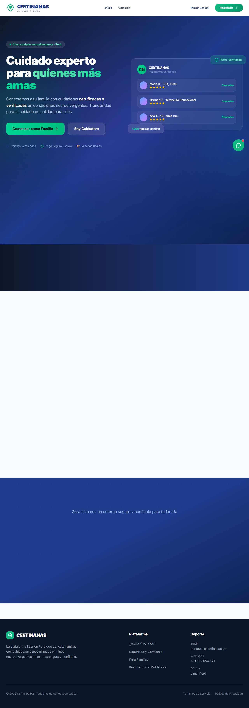
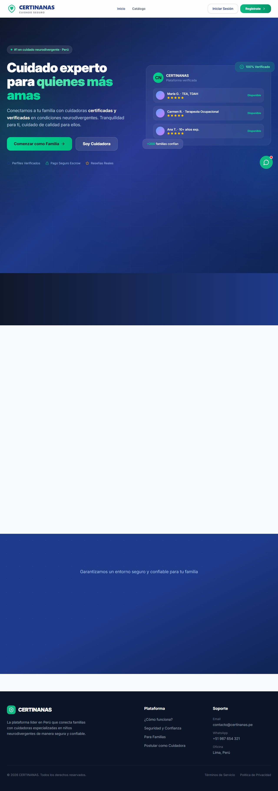
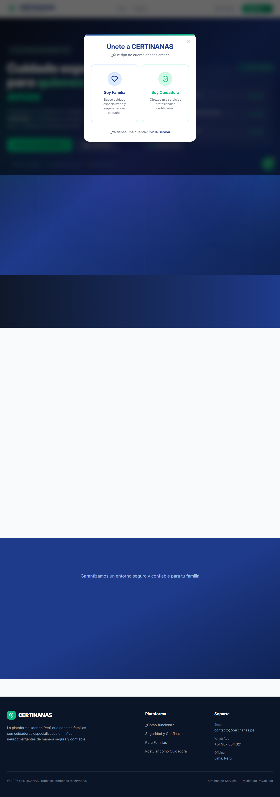

# Implementación del Prototipo - CERTINANAS

## 3.3.1 HTML — Estructura del Prototipo (Figura 14)

La estructura HTML del prototipo está implementada con **React + TypeScript + JSX**. Cada componente representa una sección de la interfaz:

**App.tsx** — Componente raíz que gestiona la navegación por estados y el layout principal:

```tsx
// src/app/App.tsx (extracto - estructura principal)
function AppContent() {
  const { user, logout, loading } = useAuth();
  const [view, setView] = useState<View>('home');

  useEffect(() => {
    if (loading) return;
    if (!user) { setView('home'); return; }
    if (user.rol === 'cuidadora') setView('cuidadora');
    else if (user.rol === 'admin') setView('admin');
    else setView('search');
  }, [loading, user?.id]);

  return (
    <div className="min-h-screen bg-gradient-to-br from-[#210635] via-[#420D4B] to-[#7B337E]">
      {/* Navbar principal */}
      <header className="bg-[#210635]/80 backdrop-blur-[20px] border-b border-[rgba(255,255,255,0.1)] text-white sticky top-0 z-40">
        <div className="max-w-7xl mx-auto px-4 sm:px-6 lg:px-8">
          <div className="flex items-center justify-between h-16">
            <Logo />
            <nav className="flex items-center gap-6">
              {isFamily && (
                <>
                  <button onClick={() => setView('search')}>Inicio</button>
                  <button onClick={() => setView('familia')}>Mis Servicios</button>
                  <button onClick={() => setView('messages')}>Mensajes</button>
                </>
              )}
              {user && <ProfileAvatar size={36} />}
              <button onClick={logout}><LogOut /></button>
            </nav>
          </div>
        </div>
      </header>

      {/* Renderizado condicional de vistas */}
      {view === 'home' && <HeroLanding onRegisterFamily={() => setView('search')} />}
      {view === 'search' && user?.rol === 'familia' && <SearchPage onNavigate={setView} />}
      {view === 'cuidadora' && user?.rol === 'cuidadora' && <CaregiverPanel onNavigate={setView} />}
      {view === 'admin' && user?.rol === 'admin' && <AdminLayout onNavigate={setView} />}
      {view === 'familia' && <FamilyPanel onNavigate={setView} />}
      {view === 'messages' && <MessagesPage onNavigate={setView} />}
      {view === 'contract' && <ContractPage orderId={contractOrderId!} onBack={() => setView('familia')} />}
      {view === 'payment' && <PaymentPage orderId={contractOrderId!} onBack={() => setView('familia')} />}

      <AuthModal isOpen={authModalConfig.isOpen} mode={authModalConfig.mode} onClose={() => setAuthModalConfig(prev => ({ ...prev, isOpen: false }))} />
    </div>
  );
}
```

**HeroLanding.tsx** — Componente de aterrizaje con secciones:

```tsx
// src/app/components/HeroLanding.tsx (extracto)
<section id="inicio" className="relative bg-gradient-to-br from-[#210635] via-[#420D4B] to-[#7B337E] overflow-hidden">
  <div className="relative z-10 max-w-7xl mx-auto px-4 pt-20 pb-24">
    {/* Badge de plataforma #1 */}
    <div className="inline-flex items-center gap-2 px-4 py-1.5 rounded-full bg-[rgba(33,6,53,0.65)] backdrop-blur-[20px]">
      <span className="text-xs font-bold tracking-wide text-[#F5D5E0]">
        La plataforma #1 en cuidado neurodivergente · Perú
      </span>
    </div>

    {/* Título principal */}
    <h1 className="text-[2.75rem] sm:text-5xl lg:text-[4.25rem] font-extrabold text-white leading-[1.05]">
      Conectamos a tu familia con{' '}
      <span className="bg-gradient-to-r from-[#F6A5C0] to-[#CC8DB3] bg-clip-text text-transparent">
        cuidadoras especializadas
      </span>
    </h1>

    {/* Tarjetas de pasos */}
    {steps.map(step => (
      <div className="bg-[rgba(33,6,53,0.65)] backdrop-blur-[20px] border border-[rgba(255,255,255,0.2)] rounded-2xl p-6">
        <step.icon className="w-8 h-8 text-[#CC8DB3]" />
        <h3 className="text-lg font-bold text-white">{step.title}</h3>
        <p className="text-sm text-[#6667AB]">{step.desc}</p>
      </div>
    ))}
  </div>
</section>
```

**AuthModal.tsx** — Modal de autenticación con tabs:

```tsx
// src/app/components/AuthModal.tsx (extracto)
<motion.div className="bg-[rgba(33,6,53,0.65)] backdrop-blur-[20px] border border-[rgba(255,255,255,0.2)] rounded-3xl max-w-md w-full">
  {/* Tabs */}
  <div className="flex bg-[rgba(33,6,53,0.4)] rounded-xl p-1">
    <button onClick={() => setCurrentMode('register')}
      className={`flex-1 py-2.5 text-sm font-bold rounded-lg transition-all ${
        currentMode === 'register' ? 'bg-[#F6A5C0] text-[#210635]' : 'text-[#6667AB]'
      }`}>Registrarme</button>
    <button onClick={() => setCurrentMode('login')}
      className={`flex-1 py-2.5 text-sm font-bold rounded-lg transition-all ${
        currentMode === 'login' ? 'bg-[#F6A5C0] text-[#210635]' : 'text-[#6667AB]'
      }`}>Iniciar sesión</button>
  </div>

  {/* Formulario de login */}
  {currentMode === 'login' ? (
    <form onSubmit={handleLogin}>
      <input type="email" placeholder="Correo electrónico"
        className="w-full rounded-xl bg-[rgba(33,6,53,0.5)] border-[rgba(255,255,255,0.3)] px-4 py-3 text-white placeholder:text-[#6667AB]" />
      <input type="password" placeholder="Contraseña"
        className="w-full rounded-xl bg-[rgba(33,6,53,0.5)] border-[rgba(255,255,255,0.3)] px-4 py-3 text-white placeholder:text-[#6667AB]" />
      <button type="submit" className="w-full py-3 bg-[#F6A5C0] text-[#210635] font-bold rounded-xl">
        Iniciar sesión
      </button>
    </form>
  ) : (
    /* Formulario de registro */
    <form onSubmit={handleRegister}>
      {/* Selector de rol */}
      <div className="flex gap-3">
        <button type="button" onClick={() => setRegisterRole('familia')}
          className={`flex-1 p-4 rounded-xl border-2 text-center ${
            registerRole === 'familia' ? 'bg-[#CC8DB3]/20 border-[#CC8DB3]' : 'border-[rgba(255,255,255,0.3)]'
          }`}>
          <Users className="w-6 h-6 text-[#CC8DB3]" />
          <span className="text-sm text-white font-semibold">Familia</span>
        </button>
        <button type="button" onClick={() => setRegisterRole('cuidadora')}
          className={`flex-1 p-4 rounded-xl border-2 text-center ${
            registerRole === 'cuidadora' ? 'bg-[#CC8DB3]/20 border-[#CC8DB3]' : 'border-[rgba(255,255,255,0.3)]'
          }`}>
          <Shield className="w-6 h-6 text-[#CC8DB3]" />
          <span className="text-sm text-white font-semibold">Cuidadora</span>
        </button>
      </div>
      <input type="text" placeholder="Nombre completo" />
      <input type="email" placeholder="Correo electrónico" />
      <input type="password" placeholder="Contraseña" />
      <button type="submit" className="w-full py-3 bg-[#F6A5C0] text-[#210635] font-bold rounded-xl">
        Crear cuenta
      </button>
    </form>
  )}
</motion.div>
```

---

## 3.3.2 CSS — Estilos del Prototipo (Figura 15)

El diseño utiliza **Tailwind CSS** con clases utilitarias y estilos personalizados para lograr el efecto **Dark Glassmorphism**. No hay archivos CSS separados; todos los estilos se aplican inline mediante clases Tailwind.

### Sistema de diseño Dark Glassmorphism

| Elemento | Clases Tailwind |
|----------|----------------|
| Fondo degradado | `bg-gradient-to-br from-[#210635] via-[#420D4B] to-[#7B337E]` |
| Tarjetas glass | `bg-[rgba(33,6,53,0.65)] backdrop-blur-[20px] border border-[rgba(255,255,255,0.2)] shadow-lg shadow-black/30 rounded-2xl` |
| Texto principal | `text-white` |
| Texto secundario | `text-[#6667AB]` |
| Texto resaltado | `text-[#F5D5E0]` |
| Inputs | `bg-[rgba(33,6,53,0.5)] border-[rgba(255,255,255,0.3)] text-white placeholder:text-[#6667AB] focus:ring-2 focus:ring-[#7B337E]` |
| Botón primario | `bg-[#F6A5C0] text-[#210635] font-bold rounded-xl hover:shadow-lg` |
| Botón secundario | `bg-[#CC8DB3] text-[#210635] font-bold rounded-xl` |
| Badge verificado | `bg-[rgba(16,185,129,0.2)] text-[#6EE7B7]` |
| Badge pendiente | `bg-[rgba(234,179,8,0.2)] text-[#FACC15]` |
| Estrellas activas | `text-[#CC8DB3] fill-[#CC8DB3]` |
| Navbar/Header | `bg-[#210635]/80 backdrop-blur-[20px] border-b border-[rgba(255,255,255,0.1)]` |

### Efectos decorativos (CSS-in-JS)

```tsx
{/* Grid de fondo con máscara radial */}
<div
  className="absolute inset-0 opacity-[0.35] pointer-events-none"
  style={{
    backgroundImage:
      'linear-gradient(to right, rgba(30,58,138,0.06) 1px, transparent 1px), linear-gradient(to bottom, rgba(30,58,138,0.06) 1px, transparent 1px)',
    backgroundSize: '56px 56px',
    maskImage: 'radial-gradient(ellipse at center, black 40%, transparent 80%)',
    WebkitMaskImage: 'radial-gradient(ellipse at center, black 40%, transparent 80%)',
  }}
/>

{/* Círculos de glow */}
<div className="absolute top-[-15%] left-[-10%] w-[55%] h-[55%] bg-[#CC8DB3]/10 rounded-full blur-[140px]" />
<div className="absolute top-[20%] right-[-15%] w-[55%] h-[55%] bg-[#210635]/10 rounded-full blur-[140px]" />
```

### Animaciones con motion/react (Framer Motion)

```tsx
<motion.div
  initial={{ opacity: 0, y: 20 }}
  animate={{ opacity: 1, y: 0 }}
  transition={{ delay: 0.1 }}
  className="bg-[rgba(33,6,53,0.65)] backdrop-blur-[20px] rounded-2xl"
>
  Contenido con animación de entrada
</motion.div>

<motion.div
  initial={{ opacity: 0 }}
  animate={{ opacity: 1 }}
  exit={{ opacity: 0 }}
  className="fixed inset-0 bg-black/40 backdrop-blur-sm z-50"
/>
```

---

## 3.3.3 JavaScript — Funcionalidades (Figura 16)

### Contexto de autenticación (AuthContext)

```tsx
// src/context/AuthContext.tsx
export function AuthProvider({ children }: { children: ReactNode }) {
  const [user, setUser] = useState<User | null>(null);
  const [loading, setLoading] = useState(true);

  useEffect(() => {
    const session = authService.getSession();
    if (session) setUser(session);
    setLoading(false);
  }, []);

  const login = async (email: string, password: string) => {
    try {
      const u = await authService.login(email, password);
      if (u) { setUser(u); return null; }
      return 'Correo o contraseña incorrectos.';
    } catch (e: any) { return e.message; }
  };

  const register = async (data) => {
    try {
      const u = await authService.register(data);
      setUser(u);
      return null;
    } catch (e: any) { return e.message; }
  };

  const logout = () => {
    authService.logout();
    setUser(null);
  };

  return (
    <AuthContext.Provider value={{ user, login, register, logout, updateFotoPerfil, loading }}>
      {children}
    </AuthContext.Provider>
  );
}

export function useAuth() {
  const ctx = useContext(AuthContext);
  if (!ctx) throw new Error('useAuth debe usarse dentro de AuthProvider');
  return ctx;
}
```

### Servicio de autenticación (API calls)

```tsx
// src/services/auth.service.ts
const API = `${import.meta.env.VITE_API_URL || ''}/api/auth`;

export const authService = {
  async login(email: string, password: string): Promise<User | null> {
    const res = await fetch(`${API}/login`, {
      method: 'POST',
      headers: { 'Content-Type': 'application/json' },
      body: JSON.stringify({ email, password }),
    });
    if (!res.ok) {
      const data = await res.json();
      throw new Error(data.error || 'Error al iniciar sesión');
    }
    const user = await res.json();
    sessionStorage.setItem('certinanas_session', JSON.stringify(user));
    return user;
  },

  async register(data): Promise<User> {
    const res = await fetch(`${API}/register`, {
      method: 'POST',
      headers: { 'Content-Type': 'application/json' },
      body: JSON.stringify(data),
    });
    if (!res.ok) {
      const err = await res.json();
      throw new Error(err.error || 'Error al registrarse');
    }
    const user = await res.json();
    sessionStorage.setItem('certinanas_session', JSON.stringify(user));
    return user;
  },

  logout(): void {
    sessionStorage.removeItem('certinanas_session');
  },

  getSession(): User | null {
    try {
      const data = sessionStorage.getItem('certinanas_session');
      return data ? JSON.parse(data) : null;
    } catch { return null; }
  },
};
```

### Búsqueda de cuidadoras con filtros

```tsx
// SearchPage.tsx — Lógica de búsqueda
const buscar = async () => {
  setLoading(true);
  try {
    const params = new URLSearchParams();
    if (especialidad && especialidad !== 'Todas') params.set('especialidad', especialidad);
    if (zona && zona !== 'Todas') params.set('zona', zona);
    if (experiencia && experiencia !== '0+ años') params.set('experiencia', experiencia.replace('+ años', ''));
    if (tarifaMax) params.set('tarifa_max', tarifaMax);
    const r = await fetch(`/api/search/cuidadoras?${params}`);
    const data = await r.json();
    setCuidadoras(data);
    setCount(data.length);
  } catch { setCuidadoras([]); setCount(0); }
  setLoading(false);
};

// Perfil completo de cuidadora
const abrirPerfil = async (c: CuidadoraCard) => {
  setSelectedNana(c);
  setCargandoPerfil(true);
  try {
    const r = await fetch(`/api/search/cuidadora/${c.Id}/perfil`);
    const data = await r.json();
    setPerfilCompleto(data);
  } catch { setPerfilCompleto(null); }
  setCargandoPerfil(false);
};
```

### Backend — API endpoints (Express.js)

```javascript
// server/index.js — Configuración del servidor
import express from 'express';
import cors from 'cors';
import { getDb } from './db.js';
import { setupDatabase } from './setup.js';

const app = express();
app.use(cors());
app.use(express.json());

app.use('/api/auth', authRoutes);
app.use('/api/admin', adminRoutes);
app.use('/api/cuidadora', cuidadoraRoutes);
app.use('/api', searchRoutes);
app.use('/api/familia', familiaRoutes);
app.use('/api/mensajes', mensajesRoutes);

// Endpoint de búsqueda de cuidadoras
router.get('/search/cuidadoras', (req, res) => {
  const { especialidad, zona, experiencia, tarifa_max } = req.query;
  let sql = `SELECT DISTINCT c.*, u.Nombres, u.Apellidos
             FROM Cuidadoras c INNER JOIN Usuarios u ON u.Id = c.IdUsuario
             WHERE c.Disponible = 1 AND u.Activo = 1`;
  const params = [];
  if (especialidad) { sql += ' AND ...'; params.push(`%${especialidad}%`); }
  if (zona) { sql += ' AND c.Zona LIKE ?'; params.push(`%${zona}%`); }
  if (experiencia) { sql += ' AND c.AniosExperiencia >= ?'; params.push(minExp); }
  if (tarifa_max) { sql += ' AND c.TarifaHora <= ?'; params.push(maxTarifa); }
  sql += ' ORDER BY c.CalificacionPromedio DESC';
  res.json(db.prepare(sql).all(...params));
});
```

### Backend — Flujo de Escrow y pagos

```javascript
// server/routes/familia.js — Pago con Escrow
router.post('/pagar/:id', (req, res) => {
  const orden = db.prepare('SELECT * FROM Ordenes WHERE Id = ?').get(Number(req.params.id));
  if (!orden) return res.status(404).json({ error: 'Orden no encontrada' });
  if (!orden.ConfirmadaFamilia) return res.status(400).json({ error: 'Debes aceptar el contrato primero' });

  db.transaction(() => {
    db.prepare("UPDATE Ordenes SET Estado = 'Pagada' WHERE Id = ?").run(orden.Id);
    db.prepare("INSERT INTO Pagos (IdOrden, Monto, MetodoPago, Estado) VALUES (?, ?, 'Tarjeta', 'Completado')").run(orden.Id, orden.Total);
    // Crear Escrow: 92% cuidadora, 8% plataforma
    db.prepare("INSERT INTO Escrow (IdOrden, MontoTotal, MontoCuidadora, MontoPlataforma, Estado) VALUES (?, ?, ?, ?, 'Retenido')")
      .run(orden.Id, orden.Total, orden.Subtotal, orden.TarifaPlataforma);
  })();

  res.json({ success: true });
});

// Liberación de Escrow cuando ambas partes confirman
router.post('/orden/:id/confirmar-finalizacion', (req, res) => {
  db.transaction(() => {
    db.prepare("UPDATE Ordenes SET FinalizadaFamilia = 1 WHERE Id = ?").run(orden.Id);
    const actualizada = db.prepare('SELECT * FROM Ordenes WHERE Id = ?').get(orden.Id);
    if (actualizada.FinalizadaFamilia && actualizada.FinalizadaCuidadora) {
      db.prepare("UPDATE Escrow SET Estado = 'Liberado' WHERE IdOrden = ?").run(orden.Id);
      db.prepare("UPDATE Ordenes SET Estado = 'Completada' WHERE Id = ?").run(orden.Id);
    }
  })();
  res.json({ success: true });
});
```

### Contrato digital

```javascript
// Generación de contrato con términos completos
const terminos = [
  'CONTRATO DE SERVICIO - CERTINANAS',
  `Fecha de servicio: ${orden.FechaServicio}`,
  `Horario: ${horario}`,
  `Tarifa: S/ ${orden.TarifaHora}/hora`,
  `Total horas: ${orden.TotalHoras}`,
  `Subtotal cuidadora: S/ ${orden.Subtotal}`,
  `Comisión plataforma (8%): S/ ${orden.TarifaPlataforma}`,
  `Total pagado: S/ ${orden.Total}`,
  '',
  'RESPONSABILIDADES DE LA CUIDADORA:',
  '- Brindar cuidado especializado al menor asignado',
  '- Cumplir con el horario acordado',
  '- Reportar cualquier incidencia durante el servicio',
  '- Mantener confidencialidad sobre información familiar',
  '',
  'RESPONSABILIDADES DE LA FAMILIA:',
  '- Proporcionar un entorno seguro para el servicio',
  '- Pagar el servicio según lo acordado',
  '- Comunicar cualquier cambio con anticipación',
  '',
  'El pago queda retenido en Escrow hasta que ambas partes confirmen la finalización.',
  'Al aceptar, ambas partes aceptan los términos y condiciones de CERTINANAS.',
].join('\n');
```

---

## Figuras 17-21 — Capturas de pantalla del prototipo

### Figura 17. Captura de implementación del prototipo — Landing Page



*Vista principal del prototipo: Hero con degradado oscuro, tarjetas glassmorphism, badges de confianza y llamado a la acción.*

### Figura 18. Captura de implementación del prototipo — Panel Administrador



*Panel de administración: sidebar con navegación, KPIs, tabla de postulaciones y chat de soporte.*

### Figura 19. Captura de implementación del prototipo — Búsqueda de Cuidadoras


*Página de búsqueda con filtros por especialidad, zona, experiencia y tarifa. Resultados con tarjetas glass.*

### Figura 20. Captura de implementación del prototipo — Modal de Autenticación



*Modal de autenticación con tabs de registro/inicio de sesión y selector de rol (Familia/Cuidadora).*

### Figura 21. Captura de implementación del prototipo — Perfil Completo de Cuidadora

*(Abrir modal "Ver perfil" desde la búsqueda para ver la vista detallada con biografía, especialidades, formación, certificaciones, documentos y reseñas)*

> **Nota:** Las capturas adicionales pueden generarse navegando la aplicación en http://localhost:5173. Para una demostración completa, iniciar sesión como admin (admin@certinanas.com / admin123) o como familia.
